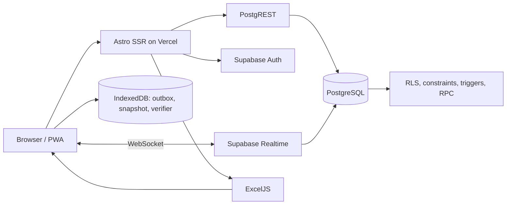
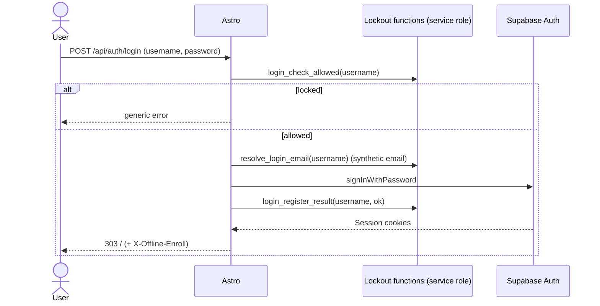
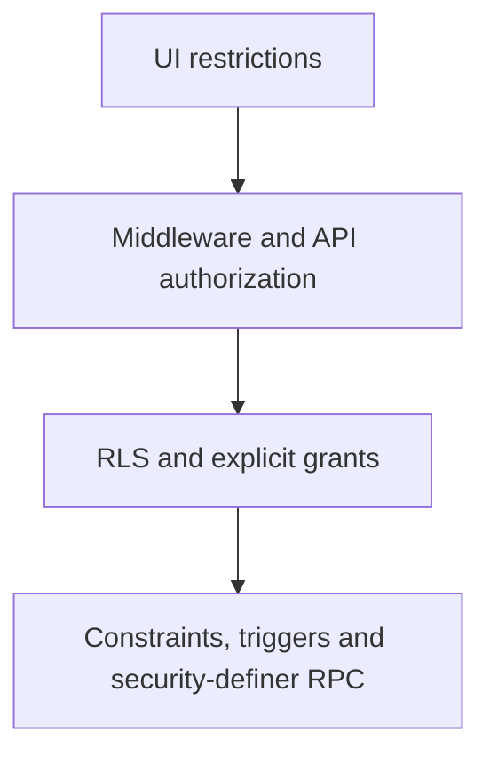
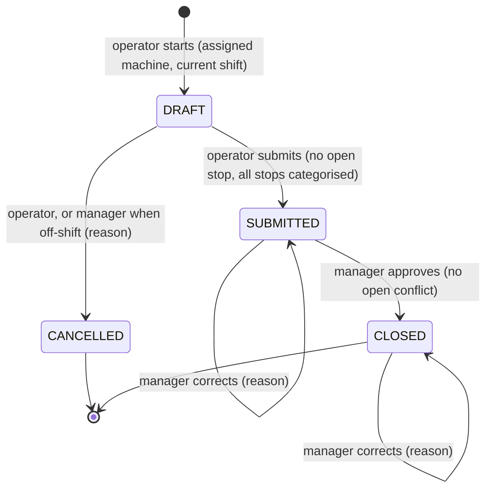
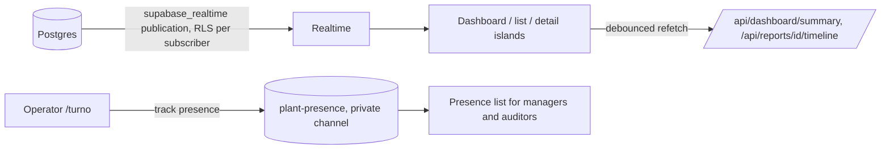
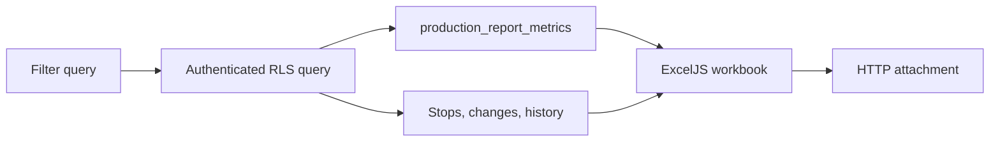

# Architecture

## System Overview

The application is an Astro 7 server-rendered application configured with the Vercel adapter. Supabase provides Auth, PostgREST, PostgreSQL (RLS, constraints, triggers, `security definer` functions) and Realtime. React 19 is used for interactive islands. ExcelJS generates reporting workbooks on the server. The browser keeps an offline outbox in IndexedDB and a service worker for the static shells.



## Roles

Four roles exist (`app_role`): `ROOT` (administrador raíz), `ADMINISTRATOR` (coordinador), `OPERATOR` (operario) and `VIEWER` (auditor). "Manager" means `ROOT` or `ADMINISTRATOR`. The database helpers `private.is_manager()` and `private.is_root()` evaluate the active caller's role and drive every RLS policy and RPC. The management matrix (ROOT manages every role, a coordinator only operators) is enforced by `manage_user_assignments` and re-checked by the API routes. See [SECURITY_AND_ABUSE.md](SECURITY_AND_ABUSE.md) for the full permission table.

## Rendering Model

Astro pages authenticate and load data on the server, then send rendered HTML. React islands cover interactive pieces: the report editor, stop manager, approval panel and correction dialog, the live dashboard/list/timeline, the presence list and the operator's offline shift (`/turno`). Three pages are **prerendered** static shells without data (`/turno`, `/consulta-offline`, `/acceso-offline`); their islands are `client:only` and read data from IndexedDB or from authenticated APIs, so the service worker can cache them safely. Administration largely uses Astro components, native forms and small page-local scripts.

The user interface is Spanish and uses `es-CO` formatting. Operational date and time presentation uses `America/Bogota`.

## Supabase Client Types

### Authenticated SSR client

The regular server client reads and writes Supabase session cookies. It calls Auth as the current user and sends that session to PostgREST, so database operations are constrained by RLS. It powers pages, report workflows, dashboards, summaries and exports.

### Server admin client

The server-only admin client uses the service-role key for Supabase Auth Admin operations required by user administration (create user with a password, reset password, ban/unban) and for the login lockout functions. Its direct database privileges are deliberately narrow. The key is not browser-accessible.

### Browser client

`src/lib/supabase/browser.ts` creates one client per tab from the publishable key and the session cookies. It is used only by Realtime (postgres_changes and presence); all reads and writes still go through the HTTP API. It is torn down on logout.

## Authentication Lifecycle

### Login by username



There is no invitation and no email recovery: the login identifier is a unique, immutable `username` and every account has a synthetic email `<username>@usuarios.reporte-produccion.invalid` that never receives mail. Five consecutive failures lock the username for 15 minutes; the error message is identical in every failure case. `getAuthContext` validates the Auth user and then loads the profile; an inactive profile is rejected even with a valid Auth session.

### User administration

A manager creates a user with an initial password (Auth Admin `createUser`, then `manage_user_assignments`, which audits `USER_CREATED`); resets passwords (`PASSWORD_RESET`); edits profile, role and assignments per machine and shift; and retires/reactivates users keeping the same UUID. Retirement and deactivation call `manage_user_assignments` with the FR-005a check: a user with an active report or devices that informed pending data cannot be deactivated; only ROOT can force it, with a reason (`FORCE_DEACTIVATE`).

### Offline login

With a connection the browser derives a PBKDF2 verifier from the typed credentials and stores it as a *pending* enrollment; the first authenticated page confirms it against `GET /api/auth/session-info`. Offline, the login form verifies against that verifier (7-day window, 5-attempt local lock) and creates a local session that only grants the screens of the last verified role. Before anything is uploaded the user must log in online again. See [PWA_OFFLINE.md](PWA_OFFLINE.md).

## Authorization Layers



UI visibility improves usability but is not the security boundary. Middleware and endpoints establish authentication and role requirements. RLS controls row visibility. Privileged mutations (approve, cancel off-shift, correct, sync, quarantine review, user management) are `security definer` functions with an empty `search_path` that validate the actor first; no policy gives managers direct `UPDATE` on reports, stops or changes.

## Report Lifecycle



Labels in the UI: `DRAFT` "Activo", `SUBMITTED` "Enviado", `CLOSED` "Cerrado (aprobado)", `CANCELLED` "Cancelado". The shift and the operational date are resolved by the database from the device start time (`private.current_shift_at`; a shift crossing midnight belongs to the day it starts). An operator has at most one active report and a machine at most one. Only the author can edit an active report; managers and auditors view it in real time. A report still active 2 hours (configurable) after its shift ends is flagged "off-shift" and may be cancelled by a manager with a reason. Approval records approver and time and is visible to every role.

## Audit

A generic trigger writes `report_audit_log` for every insert or update on reports, stops and changes (actor, role, field, old/new value, reason, offline flag, device and server times). Manager corrections go through `correct_report`, which sets the reason for the whole transaction. Administrative tables (profiles, machines, assignments, catalogs, settings) are audited by `private.audit_admin_entity` into `administrative_audit_log`, readable only by ROOT. Application roles have no write privilege on either table.

## Offline Synchronisation

```mermaid
sequenceDiagram
    participant UI as /turno (IndexedDB)
    participant API as POST /api/sync/batch
    participant RPC as apply_sync_operation
    UI->>UI: action -> outbox + local entity (device time)
    Note over UI: no network write while there are pending items
    UI->>UI: reconnect -> summary of pending data
    UI->>API: "Confirmar y subir": batches of up to 50 ordered ops
    API->>RPC: one call per operation (user = auth.uid())
    RPC-->>API: applied | duplicate | conflict | rejected
    API-->>UI: results; synced items marked, the rest stay
```

Nothing is uploaded until the author confirms. Each operation carries a client `operationId`; `sync_operation_log` makes replays idempotent (`duplicate`). Operations that cannot be applied (cancelled report, revoked assignment, conflicting version) are stored in `sync_quarantine` with the device data, the coordinator is notified, and approval is blocked while a conflict is open. Devices report only pending counts (`device_sync_status`) so that FR-005a can block deactivation.

## Real Time



Migration `20261016000100` publishes `production_reports`, `report_stop_events`, `report_change_events`, `report_audit_log` and `sync_quarantine`. Events are only a trigger: the islands re-request the authorised fragment (500 ms debounce on the dashboard, 1 s on the list). If the subscription does not reach `SUBSCRIBED` within 5 s, or the channel errors or times out, the islands fall back to polling every 8 s and show "Actualización automática cada 8 s". Presence is published only by operators with a minimal payload `{ userId, fullName, pendingCount, lastSeen }` every 30 s and on change; managers and auditors only listen. Presence is advisory (forgeable by the operator) and never grants permissions or feeds the FR-005a check.

## Excel Generation Flow



The export accepts the full filter set (operational date range, machine, shift, operator, status, active stop, off-shift), uses the authenticated client so visibility stays RLS-bound, and answers `204` when nothing matches. The workbook has the sheets SEGUIMIENTO PRODUCCIÓN, DETALLE PARADAS, CAMBIOS, HISTORIAL and CATÁLOGO PARADAS plus approval columns. Open stops show in the detail without duration; cancelled stops are excluded from totals. Limits: 1 000 reports, 10 000 stops, 50 000 history rows and 4 MiB.

## PWA and Connectivity

A root-scoped service worker (`CACHE_VERSION` v5) precaches the static shells (`/turno`, `/consulta-offline`, `/acceso-offline`), icons, manifest and content-hashed `/_astro/` assets with an atomic install. Authenticated HTML, `/api/**`, exports and Supabase responses are never stored in Cache Storage. Browser connectivity events are combined with `HEAD /api/health` to drive the connection banner and the offline indicator. See [PWA_OFFLINE.md](PWA_OFFLINE.md).
