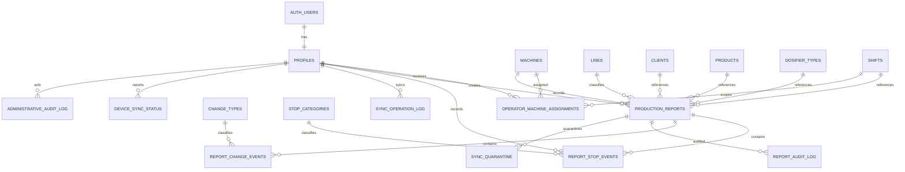

# Data Model

## Core Relationships



The diagram intentionally shows only the application’s principal relationships rather than every column and audit reference.

## Application Objects

### `profiles`

Application identity and authorization profile. Its UUID primary key references the Supabase Auth user and therefore preserves a single identity across creation, retirement, and reactivation (there is no invitation flow). Important fields include `username`, full name, job title, role, active state, `created_by`, and retirement metadata (`removed_at`, `removed_by`). Profile full names are not unique; the email in Supabase Auth is a synthetic address (`<username>@usuarios.reporte-produccion.invalid`).

- **Roles** (`app_role`): `ROOT` (administrador raíz), `ADMINISTRATOR` (coordinador), `OPERATOR` (operario) and `VIEWER` (auditor). "Manager" means `ROOT` or `ADMINISTRATOR`; the security-definer helpers `private.is_manager()` and `private.is_root()` evaluate the active caller's role and are used by every RLS policy that used to compare against `ADMINISTRATOR`.
- **`username`**: unique, lowercase, matching `^[a-z0-9._-]{3,32}$`, immutable after creation. The migration backfills it from the local part of the previous email (numeric suffix on collision). `private.handle_new_user` fills it for new Auth users from `raw_user_meta_data->>'username'` or the email local part.
- **Root invariant**: a deferred constraint trigger (`profiles_ensure_active_root`, `DEFERRABLE INITIALLY DEFERRED`) makes the commit fail when an active `ROOT` is deactivated, demoted or deleted and no other active `ROOT` remains.
- **Management matrix**: `ROOT` updates any profile; a coordinator can only update profiles whose role is `OPERATOR` and cannot promote them.

### `machines`

Machine catalog with UUID primary key, code, name, description, and active state. Reports and operator assignments reference machines.

### `operator_machine_assignments`

Links operators to permitted machines **per shift**. Primary key `id uuid`; columns `operator_id`, `machine_id`, `shift_id` (required), `valid_from` (default: today in America/Bogota), `valid_to` (nullable, `>= valid_from`), `active`, `created_by`. A partial unique index enforces `(operator_id, machine_id, shift_id) where active`. The migration expanded each pre-existing active assignment to one row per active shift. The `manage_user_assignments` RPC (which replaced `replace_operator_assignments`) replaces the operator's machine × shift assignments, each with its own validity range. Reactivation does not automatically restore old active assignments.

### Catalogs

`lines`, `clients`, `products`, `dosifier_types`, `shifts`, `stop_categories`, and `change_types` use UUID primary keys and active state. They classify report data, downtime or changes. Stop categories additionally have a numeric code used by the export’s `P-{code}` columns. `change_types` (seeded with Producto, Formato, Lote, Otro) follows the same normalized uniqueness and deletion-audit rules as the other catalogs.

`private.current_shift_at(ts timestamptz)` returns `(shift_id, operational_date, shift_end)` for the active shift containing `ts` in America/Bogota; shifts crossing midnight belong to the day they start. It returns no row when no active shift contains the instant.

### `production_reports`

The central report table uses a UUID primary key. It references its creator, machine, and optional operational catalogs. Important state fields include `status` (`DRAFT` "Activo", `SUBMITTED` "Enviado", `CLOSED` "Cerrado (aprobado)", or `CANCELLED` "Cancelado"), production timing and values, submission metadata, cancellation reason/metadata, and supported administrative-correction metadata. The table also stores its folio and historical snapshots.

- `started_at` is the device time when the report was started and is required on insert. The validation trigger resolves `shift_id` and `report_date` (operational date) from it with `private.current_shift_at`, ignoring client-supplied values; they are immutable for non-managers.
- `origin` (`online` / `offline`, default `online`) and `received_at` (server arrival time) describe how and when the row arrived.
- `approved_by`, `approved_at` and `approver_full_name` are all set when `status = 'CLOSED'` and null otherwise (check `production_reports_approval_consistency`). `approve_report` is the only way to reach `CLOSED`: it requires `SUBMITTED`, no `OPEN` row in `sync_quarantine` and no open or uncategorised stop, and emits a `REPORT_APPROVED` notification.
- Submission is rejected while a stop is open and when a closed (non-cancelled) stop has no category.
- Only one `DRAFT` per operator (`one_active_per_operator`) and per machine (`one_active_per_machine`) may exist; the previous five-draft limit and `production_reports_one_draft_per_machine` no longer exist. The migration kept each operator's most recent draft and cancelled older ones.
- `production_report_overview` (`security_invoker` view) adds `is_off_shift` (draft whose shift ended more than `app_settings.off_shift_grace` ago), `has_open_conflict`, `has_pending_review` and `active_stop` (jsonb or null).

### `report_stop_events`

Downtime events use UUID primary keys and reference a report, an optional stop category, and responsible profile. The category is optional while the stop is open and required (and active) to close it. `started_at`/`ended_at` are the device times and are no longer overwritten by the server; `received_at` is set by the server, `captured_offline` is supplied by the client and `clock_skew_review` is true when an online capture differs from arrival time by more than five minutes. An active event has no end or duration. Physical `DELETE` is not granted to anyone. Normal closed events have an authoritative duration. Cancelled events retain `cancellation_reason`, `cancelled_at`, and `cancelled_by`; their end equals cancellation time and duration is `NULL`. A check constraint enforces this representation. Existing duration sums therefore exclude cancelled stops without changing production formulas.

Operators can change category, close or cancel only active stops belonging to their own draft. They cannot change start time, elapsed duration, identity or parent report, and cannot update closed or cancelled stops. Managers never write stops directly: they correct stops of `SUBMITTED`/`CLOSED` reports only through `correct_report` (with a reason), and can cancel the open stops of an off-shift report through `cancel_report`. Stop mutation triggers lock the parent report to serialize against submission/cancellation, without updating the report's optimistic-concurrency version.

### `change_types` and `report_change_events`

`report_change_events` records product/format/lot changes inside a report: `report_id`, `change_type_id` (active type), `description` (1–500 characters), `occurred_at` (device time), `received_at`, `captured_offline`, `clock_skew_review` and `created_by` (always the report author). The `prepare_change_event` trigger mirrors the stop rules. Operators insert/update only in their own `DRAFT`; managers only on non-`DRAFT` reports; the same visibility as stops applies (the auditor reads all). No role has `DELETE`.

### `sync_operation_log`, `sync_quarantine`, `device_sync_status`

Written only by security-definer RPCs (Phase 4a). `sync_operation_log` (idempotency, one row per client `operation_id`) is readable by its user and by managers. `sync_quarantine` holds offline data that could not be applied (`OPEN`/`REVIEWED`); managers, auditors and the owning user can read it. `device_sync_status` tracks pending counts per `(user_id, device_id)` and is readable by the user and managers.

### `app_settings`

Single-row configuration table: `off_shift_grace` (default 2 hours) and `offline_login_window` (default 7 days). Authenticated users read it; only `ROOT` updates it.

### `private.login_attempts`

Failed-login counter and lock (`username`, `failed_count`, `locked_until`). Not reachable by `anon` or `authenticated`; it is read and written only by the service-role functions `login_check_allowed` and `login_register_result` (5 consecutive failures lock the username for 15 minutes, a success resets the counter).

### `report_audit_log`

Besides the original columns it stores `entity_type` (`report`/`stop`/`change`), `entity_id`, `action` (`INSERT`/`UPDATE`/`STATUS`, plus `DELETE` for the legacy stop trigger), `actor_role`, `reason`, `captured_offline`, `captured_at` and `received_at`. Stores field-level old/new values, actor, and time for manager changes already permitted by the report policies and application when the previous report state is `SUBMITTED` or `CANCELLED`. Normal report-field editing while the report is `DRAFT` is deliberately excluded. Stop creation, active category changes, normal closure, cancellation, and administrative corrections/deletions remain recorded as `stop_event.*` entries in every report state with the full old/new event. Catalog references written by current triggers include a readable snapshot so a later catalog rename does not make the event unintelligible.

The table is append-only for application-facing roles: `anon` and `authenticated` have no direct `INSERT`, `UPDATE`, or `DELETE` privilege. Audit rows are inserted by the existing `SECURITY DEFINER` trigger path; `service_role` privileges are preserved. Managers and auditors (`VIEWER`) can read the audit of reports in every state. Operarios cannot read this history. A report with audit rows cannot be deleted through a cascading foreign key, so deleting the parent cannot erase its history.

### `administrative_audit_log`

Stores selected administrative actions with actor and time (new columns: `actor_role`, `old_value`, `new_value`). The generic trigger `private.audit_admin_entity` records INSERT, UPDATE, DELETE (and DEACTIVATE/REACTIVATE when only `active` changes) on `profiles`, `machines`, `operator_machine_assignments`, `lines`, `clients`, `products`, `dosifier_types`, `shifts`, `stop_categories`, `change_types` and `app_settings` (sensitive and housekeeping fields are excluded). User management writes semantic rows instead (`USER_CREATED`, `UPDATE`, `ASSIGNMENTS_CHANGED`, `REMOVE_USER`, `REACTIVATE_USER`, `PASSWORD_RESET`, `FORCE_DEACTIVATE`, `BOOTSTRAP_ROOT`), and `OFFLINE_LOGIN` rows are written by `record_offline_login` for any role (`details`: `device_started_at`, `received_at`, `username`, `operation_id`). It does not record reads, exports or online sign-ins. Only `ROOT` can read it, and no client role can write to it.

### `production_report_metrics`

A `security_invoker` view that provides the authoritative derived production and downtime metrics while preserving the caller’s RLS context.

### `report_folio_counters`

Maintains the yearly sequence used to assign report folios. Its primary key is the year.

## Realtime Publication

Migration `20261016000100_realtime_publication.sql` adds exactly five tables to the `supabase_realtime` publication: `production_reports`, `report_stop_events`, `report_change_events`, `report_audit_log` and `sync_quarantine`. Subscribers receive only the rows their RLS allows (an operator gets their own report events; managers and auditors get all). It also adds policies on `realtime.messages` for the private `plant-presence` channel: operators may publish and read presence (Realtime requires read access to join), managers and auditors may read. Presence payloads are advisory (see [SECURITY_AND_ABUSE.md](SECURITY_AND_ABUSE.md)).

## Migration Order

Migrations are applied in filename order and must not be reordered. The enum additions (`ROOT`, `CLOSED`) are committed in their own migrations before anything that uses them.

| Migration | Purpose |
| --- | --- |
| `20260830140000` … `20261008165311` | Original MVP schema, catalogs and snapshots, cancellation, demo readiness, normalized uniqueness, service-role grants, operator workflow, audit visibility, finalized-report correction audit, notifications. |
| `20261010000100_app_role_root` | Adds `ROOT` to `app_role`. |
| `20261010000200_report_status_closed` | Adds `CLOSED` to `report_status`. |
| `20261010000300_roles_profiles_assignments` | `username`, root invariant, `is_manager`/`is_root`, `login_attempts`, assignments per shift and `current_shift_at`. |
| `20261010000400_reports_stops_device_time` | Device-time stops, server-resolved shift and operational date, one active report per operator and per machine, approval columns, `origin`/`received_at`, clock-skew review. |
| `20261010000500_change_events` | `change_types` and `report_change_events`. |
| `20261010000600_audit_sync_tables` | Full-audit columns, `sync_operation_log`, `sync_quarantine`, `device_sync_status`, `app_settings` and `production_report_overview`. |
| `20261010000700_target_rls` | RLS for the four roles. |
| `20261010000800_notification_types` | New notification types. |
| `20261011000100_auth_lockout` | Lockout functions (5 failures, 15 minutes) and username-to-email resolution. |
| `20261011000200_user_management`, `…000210_lock_user_tables` | `manage_user_assignments`, `user_last_contact`, `report_device_sync_status` and locked-down user tables. |
| `20261011000300_catalog_delete_or_deactivate` | `delete_or_deactivate`. |
| `20261011000350_full_audit` | Generic report/stop/change audit trigger. |
| `20261011000400_approval_cancellation` | `approve_report` and `cancel_report` (off-shift rule). |
| `20261011000500_correct_report`, `…000510_off_shift_legacy_drafts` | `correct_report` and handling of legacy drafts. |
| `20261012000200_admin_audit` | `audit_admin_entity` and the administrative audit triggers. |
| `20261013000100_offline_sync` | `apply_sync_operation`, `review_quarantine` and sync notifications. |
| `20261013000200_drop_frequent_values` | Removes the "frequent values" feature. |
| `20261015000100_record_offline_login` | `record_offline_login` and a partial unique index on `administrative_audit_log` (idempotent, one row per offline sign-in). The earlier `20261014000100_offline_login_audit` was withdrawn before any deployment. |
| `20261016000100_realtime_publication` | Realtime publication (5 tables) and `plant-presence` policies. |

## Report Identity and Snapshots

Report folios have the immutable form `RPT-YYYY-NNNNNN`. The year comes from `report_date` when available, otherwise the database current date, and a yearly counter supplies the sequence.

Creator identity is copied into immutable full-name, job-title, and role snapshot fields. Client and product names are also stored as report snapshots so later catalog changes do not rewrite those historical labels. Other catalog relationships should not be assumed to be snapshots: the schema retains their current foreign-key relationships.

## Catalog Integrity

Catalog uniqueness is based on:

```sql
lower(btrim(value))
```

This ignores leading and trailing whitespace and letter casing, preserves internal whitespace, and preserves accents. Inactive rows remain included, so deactivation does not free a code or name for reuse.

Normalized uniqueness applies to machine, product, client, line, and dosifier type codes and names; non-null shift names; and stop-category names. Stop-category numeric codes are also numerically unique, so textual inputs such as `1` and `01` cannot coexist.

## Operational Constraints

- An operator must have an active assignment to the active machine for the shift and operational date resolved from the report's `started_at` (within `valid_from`/`valid_to`).
- A machine can have only one `DRAFT` report at a time, and an operator can have only one `DRAFT` report at a time (partial unique indexes).
- A report can have only one open downtime event, and its downtime intervals cannot overlap.
- A report cannot be submitted or cancelled while a stop is open.
- Creator identity and folio are immutable.
- Finalized state is protected from ordinary operator edits and normal status transitions.
- Nonnegative and time-order checks protect applicable production and timing values.
- Cancellation and profile-removal metadata must remain internally consistent.
- Foreign keys prevent deletion where historical references must be preserved.

## Production Metrics

`production_report_metrics` is the authoritative source for derived metrics. It uses only closed stop durations:

```text
theoretical_units_per_hour = g_min * 60

total_downtime_seconds =
  sum(duration_seconds for closed stops)

total_downtime_hours =
  total_downtime_seconds / 3600

net_productive_hours =
  programmed_hours - total_downtime_hours

theoretical_target =
  theoretical_units_per_hour * programmed_hours

net_target =
  theoretical_units_per_hour * net_productive_hours

theoretical_performance =
  units_produced / theoretical_target

net_performance =
  units_produced / net_target
```

Open and cancelled stops contribute no duration. Every category of valid closed stop contributes to the total. Division uses a null denominator guard, so performance is `NULL` rather than an error when the corresponding target is zero. Net productive hours are not clamped by the view.

**Process %** and **Operator %** remain stored for administrative functionality. They and other management metrics are hidden from Operator editing and read-only report views.
