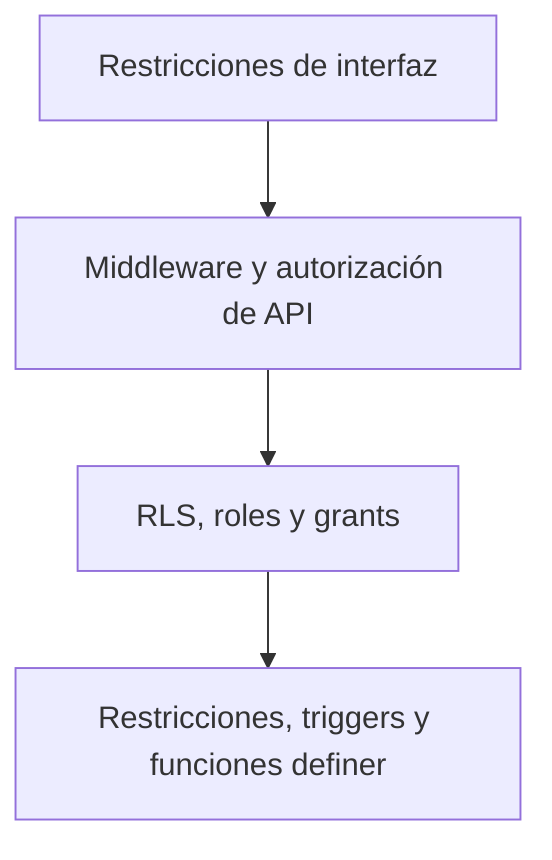

# Uso Permitido, Restricciones y Controles de Seguridad

Este documento describe el uso operativo esperado y los controles verificables del proyecto. No constituye términos legales de servicio ni una política jurídica de privacidad.

## 1. Propósito

La plataforma registra información de producción y mantenimiento que puede afectar decisiones operativas. Su uso debe conservar la identidad de quien actúa, la exactitud de los reportes, las asignaciones de máquinas y la confidencialidad de las exportaciones.

## 2. Roles y matriz de gestión

La plataforma tiene exactamente cuatro roles. Los permisos se aplican en el servidor y en la base de datos (RLS, triggers y funciones `security definer`), no solo en la interfaz.

| Rol | Qué puede hacer | Qué no puede hacer |
| --- | --- | --- |
| **Administrador raíz** (`ROOT`) | Todo lo del coordinador; crear, editar, desactivar y reactivar coordinadores y auditores; restablecer contraseñas de cualquier usuario; ver el historial administrativo; forzar la desactivación de un usuario con pendientes (con motivo). | Editar o borrar el historial de auditoría; dejar la plataforma sin un raíz activo. |
| **Coordinador** (`ADMINISTRATOR`) | Gestionar **operarios**, máquinas, asignaciones por turno y catálogos; ver reportes de todos; aprobar y cerrar; corregir reportes enviados o cerrados con motivo; cancelar reportes abiertos fuera de turno; revisar la cuarentena de sincronización; exportar. | Crear o editar coordinadores, auditores o el raíz; editar un reporte activo; forzar la desactivación de un usuario con pendientes; ver el historial administrativo. |
| **Operario** (`OPERATOR`) | Iniciar, completar, enviar y cancelar **sus propios** reportes de las máquinas que tiene asignadas en el turno vigente, también sin conexión; ver solo lo suyo. | Ver reportes ajenos, administrar, exportar, crear o modificar elementos de catálogo, editar un reporte enviado, cerrado o cancelado. |
| **Auditor** (`VIEWER`) | Ver todos los reportes, su historial de cambios y el tablero en vivo; exportar. | Cualquier escritura (crear, editar, cancelar, cerrar o eliminar), por cualquier vía. |

Matriz de gestión de usuarios: el administrador raíz gestiona a cualquier rol; un coordinador solo gestiona usuarios con rol `OPERATOR` y no puede promoverlos. Se valida antes de cualquier cambio de datos (API) y de nuevo en la base de datos.

## 3. Uso esperado

- Usar una cuenta individual asignada a la persona correcta y mantener la contraseña privada.
- Registrar únicamente máquinas autorizadas para el operario.
- Ingresar información fiel sobre producción, paradas y cambios.
- Enviar o cancelar (con motivo) los reportes mediante los flujos disponibles.
- Consultar y exportar solamente la información necesaria para funciones autorizadas.
- Mantener usuarios, roles, asignaciones y catálogos de forma responsable.

## 4. Conductas no permitidas

- Compartir credenciales o utilizar la cuenta de otra persona.
- Manipular direcciones URL o solicitudes para acceder a registros no autorizados.
- Intentar crear reportes para máquinas inactivas o no asignadas.
- Alterar la hora del dispositivo, marcas de tiempo, estados o duraciones por fuera de los flujos soportados.
- Intentar mantener varias paradas abiertas, intervalos superpuestos o más de un reporte activo.
- Recrear una identidad retirada en vez de reactivar la existente.
- Crear variantes de nombres o códigos para evadir restricciones de duplicados.
- Distribuir archivos exportados a personas sin autorización.
- Divulgar contraseñas, tokens, claves privadas o la clave `service_role`.
- Intentar utilizar funciones administrativas sin el rol correspondiente.
- Falsear datos de presencia o de pendientes desde las herramientas del navegador (ver sección 8).

## 5. Controles técnicos implementados

- **Inicio de sesión por usuario:** nombre de usuario único y contraseña; no hay correo de invitación ni recuperación por correo. El alta y el restablecimiento los hace un usuario con permiso sobre esa cuenta y quedan en el historial administrativo.
- **Bloqueo temporal:** 5 intentos fallidos seguidos bloquean al usuario 15 minutos; el mensaje es idéntico exista o no el usuario ("Usuario o contraseña incorrectos") y la comprobación del usuario no revela su existencia. Aplica también al inicio de sesión sin conexión (bloqueo local por dispositivo).
- **Supabase Auth y cookies SSR:** el servidor actúa como el usuario autenticado; la clave `service_role` solo se usa en servidor y con privilegios directos estrechos.
- **Perfil activo:** el contexto de autenticación rechaza perfiles inactivos o retirados.
- **Middleware y roles:** `/administracion` y `/api/admin` solo para raíz y coordinador; `/administracion/historial` y `/api/admin/audit` solo para raíz; `/turno` solo operarios; tablero y consulta sin conexión para coordinadores y auditores.
- **RLS:** limita filas visibles y modificables por la sesión; los operarios solo ven lo suyo, los auditores todo en solo lectura.
- **Funciones `security definer` con `search_path` vacío:** toda mutación privilegiada (aprobar, cancelar fuera de turno, corregir, sincronizar, revisar cuarentena, gestionar usuarios) valida actor activo, rol, propiedad y estado como primeras instrucciones. Ninguna política concede `UPDATE` directo a coordinadores sobre reportes, paradas o cambios.
- **Un reporte activo:** como máximo un reporte activo por operario y uno por máquina (índices únicos parciales), también para lo capturado sin conexión.
- **Reporte activo protegido:** solo su operario autor puede editarlo; coordinadores y raíz solo lo visualizan hasta que se envía.
- **Aprobación y cierre:** solo reportes `SUBMITTED` sin conflictos de sincronización abiertos; el reporte `CLOSED` conserva aprobador y hora y solo se corrige con motivo (mínimo 5 caracteres).
- **Cancelación fuera de turno:** un coordinador o raíz solo puede cancelar un reporte activo que siga abierto pasado el margen (2 h por defecto, `app_settings.off_shift_grace`) del fin de su turno, con motivo y con conexión.
- **Invariante raíz:** un trigger diferido impide que quede la plataforma sin un administrador raíz activo.
- **Desactivar con pendientes (FR-005a):** se bloquea si el usuario tiene un reporte activo o algún dispositivo informó pendientes. Solo el raíz puede forzarlo con un motivo de al menos 10 caracteres; queda `FORCE_DEACTIVATE` y el usuario queda marcado "Posibles datos sin subir". Los dispositivos informan solo conteos, nunca datos.
- **Horas del dispositivo (FR-008a):** las horas de paradas y cambios son las del dispositivo y no son editables; el servidor guarda la hora de llegada, rechaza horas futuras y marca para revisión las diferencias mayores de 5 minutos.
- **Sincronización:** `POST /api/sync/batch` solo acepta al operario autor; es idempotente por `operationId`; lo que no puede aplicarse va a cuarentena (`sync_quarantine`) y notifica al coordinador. Los datos pendientes están aislados por usuario en el dispositivo.
- **Inicio de sesión sin conexión:** verificador PBKDF2-SHA-256 de 600 000 iteraciones con sal aleatoria; la contraseña nunca se guarda. Otorga solo los permisos del rol de la última verificación con conexión y antes de subir se revalida la identidad en línea.
- **Cache Storage:** el service worker nunca guarda HTML autenticado, respuestas `/api/**` ni datos de reportes.
- **Integridad:** restricciones de estados, identidad histórica inmutable (folio y creador), paradas sin solapamiento, índices normalizados contra duplicados e identidad que se retira y reactiva sin cambiar de UUID.
- **Tiempo real:** `postgres_changes` sobre cinco tablas con la RLS de cada suscriptor (un operario no recibe eventos de reportes ajenos) y canal de presencia privado con políticas sobre `realtime.messages`.
- **Tablero acotado:** `/api/dashboard/summary` rechaza con 422 rangos de más de 366 días.

La interfaz mejora la experiencia, pero no es la barrera de seguridad principal. Los controles de servidor y base de datos deben mantenerse aunque un botón no sea visible.

## 6. Auditoría

- **Historial de reportes (`report_audit_log`)**: toda creación y modificación de reportes, paradas y cambios, por cualquier rol, con autor, rol, fecha, campo, valor anterior y nuevo, motivo cuando aplica, indicador de captura sin conexión y la hora real de llegada al servidor. Lo leen coordinadores, raíz y auditores; los operarios no.
- **Historial administrativo (`administrative_audit_log`)**: altas, ediciones, desactivaciones, reactivaciones y eliminaciones de usuarios, contraseñas restablecidas (sin guardar la contraseña), roles, máquinas, asignaciones, catálogos y ajustes, además de `FORCE_DEACTIVATE`, `BOOTSTRAP_ROOT` y `OFFLINE_LOGIN`. Solo lo lee el administrador raíz, con filtros por fecha, autor y acción.
- **Inalterable:** `anon` y `authenticated` no tienen `INSERT`, `UPDATE` ni `DELETE` sobre ninguna tabla de auditoría ni sobre `sync_operation_log`, `sync_quarantine` ni `device_sync_status`; las filas las escriben disparadores y funciones de base de datos. Nadie, incluido el raíz, puede editarlas o borrarlas desde la aplicación.

## 7. Responsabilidades administrativas

- Asignar el rol mínimo necesario y revisar las máquinas y turnos de cada operario.
- Retirar oportunamente identidades que ya no deben ingresar y reactivar la misma identidad cuando corresponda.
- Revisar la cuarentena de sincronización y los reportes abiertos fuera de turno.
- Revisar los datos antes de corregir reportes enviados o cerrados e indicar siempre un motivo claro.
- Desactivar catálogos con historia en lugar de forzar su eliminación.
- Proteger las variables de entorno y limitar quién puede administrarlas; no usar el `.env` de producción para pruebas locales.
- Definir por fuera del repositorio los procesos de monitoreo, respaldo, retención y respuesta a incidentes que la organización requiera.
- Usar tabletas gestionadas (modo kiosco, hora automática bloqueada, sin acceso a las herramientas del navegador) cuando se trabaje sin conexión.

## 8. Presencia en tiempo real: solo indicativa

La presencia ("En línea", "En línea con pendientes", "Sin conexión") la publica cada dispositivo del operario en el canal privado `plant-presence` con un payload mínimo `{ userId, fullName, pendingCount, lastSeen }`; la máquina y el reporte se obtienen siempre del servidor.

**Limitación aceptada:** el payload lo construye el navegador del operario, por lo que un operario con las herramientas de desarrollador puede falsearlo (por ejemplo, publicar otro `userId` o un `pendingCount` distinto). Por eso:

- la presencia es **solo indicativa** para la supervisión; no concede ningún permiso ni acceso;
- **no alimenta FR-005a**: el bloqueo de desactivación usa únicamente el estado que el dispositivo informa por `POST /api/device-status` (autenticado como el propio usuario, vía `report_device_sync_status`, que escribe siempre para `auth.uid()`) y los reportes activos del servidor;
- no se toman decisiones de seguridad, aprobación ni sincronización a partir de ella;
- las políticas de `realtime.messages` limitan quién puede publicar (solo `OPERATOR`) y quién puede leer (coordinadores, raíz y auditores), pero no verifican el contenido del payload.

## 9. Protección de exportaciones

Solo raíz, coordinador y auditor pueden llamar a la exportación; el operario recibe una denegación incluso si intenta la URL manualmente. La consulta usa la sesión SSR normal y permanece sujeta a RLS. Los filtros activos (rango de fechas operativas, máquina, turno, operario, estado, parada activa, fuera de turno) se trasladan a la exportación, que incluye las hojas de paradas, cambios e historial; los límites (1 000 reportes, 10 000 paradas, 50 000 filas de historial y 4 MiB) evitan entregar silenciosamente un archivo truncado.

Los archivos pueden contener información de producción y personas responsables. Deben guardarse y compartirse únicamente en ubicaciones autorizadas. El repositorio no implementa una política organizacional de clasificación o retención de esos archivos.

## 10. Gestión de usuarios retirados

Retirar conserva UUID e historia, aplica una prohibición en Auth, marca el perfil como retirado y desactiva asignaciones. Reactivar elimina la prohibición sobre la misma identidad y exige seleccionar explícitamente las asignaciones que se habilitarán; no restaura automáticamente las antiguas. Ninguno de estos flujos crea otra persona ni envía correos. Un nombre de usuario retirado no se reutiliza: la reactivación es el flujo previsto.

## 11. Limitaciones conocidas

El repositorio no establece actualmente:

- Autenticación multifactor (MFA).
- Limitación de solicitudes a nivel de aplicación más allá del bloqueo por usuario del inicio de sesión (y el límite de 20 inicios de sesión sin conexión por usuario y hora al sincronizarlos).
- Monitoreo integral de seguridad o alertas operativas.
- Auditoría de lecturas, exportaciones, inicios de sesión en línea ni intentos fallidos (sí se auditan los inicios de sesión sin conexión).
- Política de retención de datos.
- Política o automatización de respaldos y recuperación ante desastres.
- Términos legales de privacidad o uso aceptable.
- Respuesta automatizada a incidentes.
- Protección frente a un dispositivo comprometido en modo sin conexión: la ventana de 7 días, el bloqueo local y la sesión local dependen del reloj del dispositivo, y el resumen de la consulta sin conexión se guarda sin cifrar en IndexedDB.
- Cookies `sb-*` no HttpOnly (comportamiento por defecto de `@supabase/ssr`, necesario para Realtime y el cierre de sesión sin conexión); en producción se debe verificar su estado.

Estas ausencias no deben sustituirse por suposiciones sobre el proveedor de plataforma. Deben evaluarse y configurarse según el entorno y las obligaciones de la organización.
