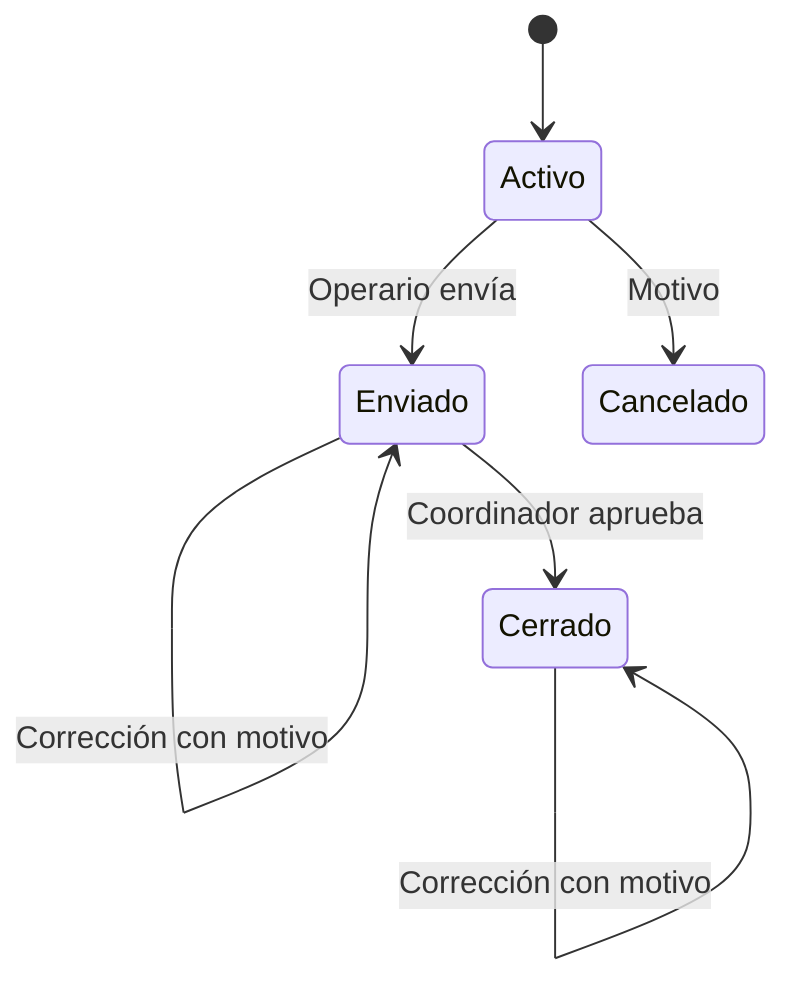

# Manual de Usuario

## Reporte Diario de Producción y Mantenimiento

## 1. Objetivo

La aplicación permite registrar, consultar y consolidar la producción por turno y las paradas y cambios de cada máquina, incluso cuando se pierde la conexión. Cada persona debe usar su propia cuenta y realizar únicamente las acciones disponibles para su rol.

## 2. Roles disponibles

| Rol | Uso principal |
| --- | --- |
| Administrador raíz | Todo lo del coordinador, más la gestión de coordinadores y auditores y el historial administrativo. |
| Coordinador | Supervisa los reportes en tiempo real, los aprueba y cierra, corrige reportes enviados o cerrados con un motivo, administra operarios, máquinas, asignaciones y catálogos, y exporta a Excel. |
| Operario | Inicia y trabaja sus propios reportes de las máquinas asignadas en su turno, también sin conexión. |
| Auditor | Consulta todos los reportes y su historial de cambios, y exporta. No puede modificar nada. |

## 3. Iniciar sesión

1. Abra **Iniciar sesión**.
2. Escriba su **usuario** (el nombre de usuario que le asignó su coordinador o el administrador) y su contraseña.
3. Seleccione **Iniciar sesión**.

El sistema abrirá la pantalla de su rol (el operario entra a **Turno**). Si escribe mal los datos verá siempre el mismo mensaje, "Usuario o contraseña incorrectos". Tras **5 intentos fallidos seguidos** el usuario se bloquea **15 minutos**, incluso con la contraseña correcta. Un usuario desactivado o retirado no puede ingresar.

**No existe recuperación de contraseña por correo ni invitaciones.** Si olvidó su contraseña o está bloqueado por error, pida a su coordinador (operarios) o al administrador raíz (coordinadores y auditores) que la restablezca; le darán una contraseña nueva.

## 4. Panel principal (coordinador, raíz y auditor)

El **Dashboard** se actualiza **sin recargar la página** y muestra:

- Reportes **en curso**, **enviados**, **cerrados**, **cancelados**, **en parada** y **abiertos fuera de turno** (cada tarjeta lleva a la lista filtrada).
- **Máquinas en parada** ahora mismo y **conflictos de sincronización** pendientes de revisar.
- **Operarios en línea**: "En línea", "En línea con pendientes" o "Sin conexión" con la última vez. Es solo un indicador orientativo.
- Una tabla con los reportes recientes.

Debajo del título verá "Actualización en vivo". Si el tiempo real no está disponible, verá "Actualización automática cada 8 s" y el tablero sigue funcionando.

## 5. Estados de un reporte

- **Activo:** el operario lo está diligenciando. **Solo su operario puede editarlo**; coordinadores y auditores lo ven en tiempo real. Si sigue abierto 2 horas después de terminar el turno aparece como **Abierto fuera de turno**.
- **Enviado:** el operario lo finalizó. El operario ya no lo edita.
- **Cerrado (aprobado):** el coordinador lo aprobó. Todos los roles ven **quién lo aprobó y cuándo**.
- **Cancelado:** quedó anulado con un motivo.

## 6. Flujo del operario: pantalla «Turno»

Su reporte se trabaja en **Turno** (`/turno`), que funciona también **sin conexión** una vez que la abrió con conexión al menos una vez (se descargan sus máquinas asignadas y los catálogos).

1. Elija su **máquina asignada** del turno actual y pulse **Iniciar reporte**. El turno y la fecha operativa los asigna el sistema según la hora de inicio; usted no los escribe. Si no tiene máquina verá «Solicita una asignación a tu coordinador».
2. Solo puede tener **un reporte activo a la vez**. Al enviarlo o cancelarlo puede iniciar otro.
3. **Iniciar parada** es de un toque; la categoría es opcional al iniciar, pero **Cerrar parada** exige elegirla. Una parada iniciada por error se puede **Cancelar parada** con un motivo. No puede haber paradas solapadas ni más de una abierta.
4. **Cambios:** elija el tipo (producto, formato, lote u otro), escriba una descripción y pulse **Registrar cambio**.
5. **Datos de producción:** todos los campos son obligatorios salvo Observaciones; se guardan solos.
6. La hora de cada parada y cada cambio es la del reloj de su dispositivo en ese momento y no se puede editar. **Revise que la hora de su dispositivo sea correcta.**
7. **Enviar reporte** exige que no haya paradas abiertas ni paradas sin categoría y que los campos obligatorios estén completos (se resaltan los que faltan). **Cancelar reporte** pide un motivo.

Arriba verá siempre el estado de conexión y los pendientes, por ejemplo «Sin conexión — guardado en este dispositivo · 3 pendientes».

### Trabajar sin conexión y subir los datos

- Todo lo que registre sin conexión se guarda en su dispositivo, aunque cierre la aplicación o se reinicie.
- Al volver la conexión aparece el **resumen de pendientes** (reportes, paradas, cambios y envíos). **Nada se sube hasta que pulse «Confirmar y subir».** Con **Posponer** todo se conserva y se vuelve a ofrecer al reconectar, al iniciar sesión o desde el indicador.
- Si la conexión se corta a mitad de la subida, lo ya aceptado queda subido y el resto sigue pendiente; nada se duplica.
- Si algún dato es rechazado o queda en conflicto (por ejemplo, el reporte fue cancelado por el coordinador porque quedó abierto fuera de turno), seguirá visible con el motivo y el coordinador lo revisará; solo se descarta si usted lo confirma.
- Si su sesión venció, sus datos se conservan: inicie sesión de nuevo y súbalos.
- **Cerrar sesión con datos sin subir** pide confirmación; los datos quedan en el dispositivo asociados a su usuario y otro usuario del mismo dispositivo no puede verlos ni subirlos.
- Si tiene pendientes de más de 7 días verá un aviso: súbalos cuanto antes.
- Instale la aplicación en la pantalla de inicio. En iPhone/iPad el sistema puede borrar los datos de un sitio sin uso durante varios días: **no deje datos sin subir**.

### Iniciar sesión sin conexión

- Puede entrar **sin conexión** con su usuario y contraseña solo si inició sesión **con conexión** en este mismo dispositivo en los últimos 7 días. Si no, verá «Necesitas conexión para entrar».
- Con la contraseña equivocada 5 veces el acceso se bloquea 15 minutos en ese dispositivo.
- Al volver la conexión debe **iniciar sesión de nuevo con conexión** antes de poder subir lo capturado. Si su usuario fue desactivado mientras tanto, sus datos se conservan en el dispositivo; un coordinador puede reactivarlo para que usted mismo los suba.
- Cada inicio de sesión sin conexión queda registrado en el historial de auditoría cuando se sincroniza.

## 7. Consultar reportes

La lista **Reportes** (coordinador, raíz y auditor) se actualiza sola y muestra folio, fecha, máquina, orden de producción, operario, estado y la acción **Abrir**. El operario solo ve sus propios reportes.

Al abrir un reporte, coordinador, raíz y auditor ven el detalle completo y su **historial de cambios en orden cronológico** (quién, cuándo, qué campo, valor anterior y nuevo, motivo y si el dato se capturó sin conexión). Si otra persona modifica el reporte mientras lo mira, el historial se actualiza sin recargar.

### Filtros

Puede combinar: **Desde** y **Hasta** (fecha operativa del reporte), **Máquina**, **Turno**, **Operario** (coordinador, raíz y auditor), **Estado** (Activo, Enviado, Cerrado, Cancelado), **Con parada activa** y **Abiertos fuera de turno**. Los atajos **Día**, **Semana** y **Mes** rellenan el rango. La zona horaria operativa es `America/Bogota`. Si ningún reporte cumple el filtro verá «No hay reportes…».

## 8. Aprobar y corregir (coordinador y raíz)

- **Aprobar y cerrar:** en un reporte **Enviado**. No se puede aprobar un reporte activo, cancelado o con datos en conflicto sin resolver; la pantalla indica el motivo.
- **Corregir:** en un reporte **Enviado** o **Cerrado** modifique el dato y guarde; la ventana **Corregir reporte** pide un **motivo obligatorio** (mínimo 5 caracteres) y queda registrado con su nombre y rol.
- **Cancelar (abierto fuera de turno):** solo aparece cuando un reporte activo lleva más de 2 horas abierto después de terminar su turno; pide un motivo.
- **Conflictos de sincronización:** en el detalle puede **Marcar revisado** o **Aplicar con motivo** los datos capturados sin conexión que no se pudieron aplicar.
- Un reporte **Activo** no tiene controles de edición para coordinadores ni auditores.

Aprobar, corregir, cancelar y exportar requieren conexión.

## 9. Auditor

El auditor ve todos los reportes (activos, enviados, cerrados y cancelados) y su historial, puede filtrar y descargar el Excel, pero **no tiene ningún control de edición**: cualquier intento de modificar es rechazado.

## 10. Consulta sin conexión (coordinador, raíz y auditor)

Sin conexión verá **Consulta sin conexión**: el último resumen descargado, de solo lectura y marcado con su hora («Datos de HH:MM»). Exportar, corregir, aprobar, cancelar y administrar requieren conexión y aparecen deshabilitados.

## 11. Exportación Excel

Coordinador, raíz y auditor pueden **Exportar Excel** respetando exactamente los filtros activos. El archivo contiene:

- **SEGUIMIENTO PRODUCCIÓN:** resumen del reporte, producción, métricas y aprobación (aprobador y fecha).
- **DETALLE PARADAS:** una fila por evento; las paradas abiertas no suman duración.
- **CAMBIOS:** los cambios registrados.
- **HISTORIAL:** el historial de cambios de esos reportes.
- **CATÁLOGO PARADAS:** relación entre códigos y categorías.

Las columnas `P-1`, `P-2`… son el tiempo cerrado por categoría de parada. Si el filtro no devuelve reportes no se genera archivo. Si el volumen supera los límites (1 000 reportes) se pide un período más corto.

## 12. Mensajes y errores frecuentes

| Mensaje o situación | Acción recomendada |
| --- | --- |
| «Usuario o contraseña incorrectos» | Revise el usuario y la contraseña. Tras 5 fallos espere 15 minutos o pida el restablecimiento. |
| «Solicita una asignación a tu coordinador» | No tiene máquina asignada en el turno actual. |
| «Ya tienes un reporte activo» | Envíe o cancele el reporte activo antes de iniciar otro. |
| No puede enviar | Cierre o cancele la parada abierta, asigne categoría a todas las paradas y complete los campos obligatorios. |
| «Necesitas conexión para entrar» | Inicie sesión una vez con conexión en este dispositivo. |
| «Inicia sesión en línea para subir» | Inicie sesión con conexión para poder confirmar la subida. |
| No se puede exportar | Confirme el rol, reduzca el período o revise el mensaje específico. |
| Un coordinador no puede desactivar a un operario | El operario tiene un reporte activo o datos pendientes de subir. |

## 13. Buenas prácticas de uso

- Use únicamente su cuenta y mantenga la contraseña privada.
- Mantenga la hora de su dispositivo en automático.
- Inicie y cierre las paradas cuando realmente ocurran.
- Suba sus datos pendientes en cuanto tenga conexión.
- Exporte y comparta información solo con personas autorizadas.
